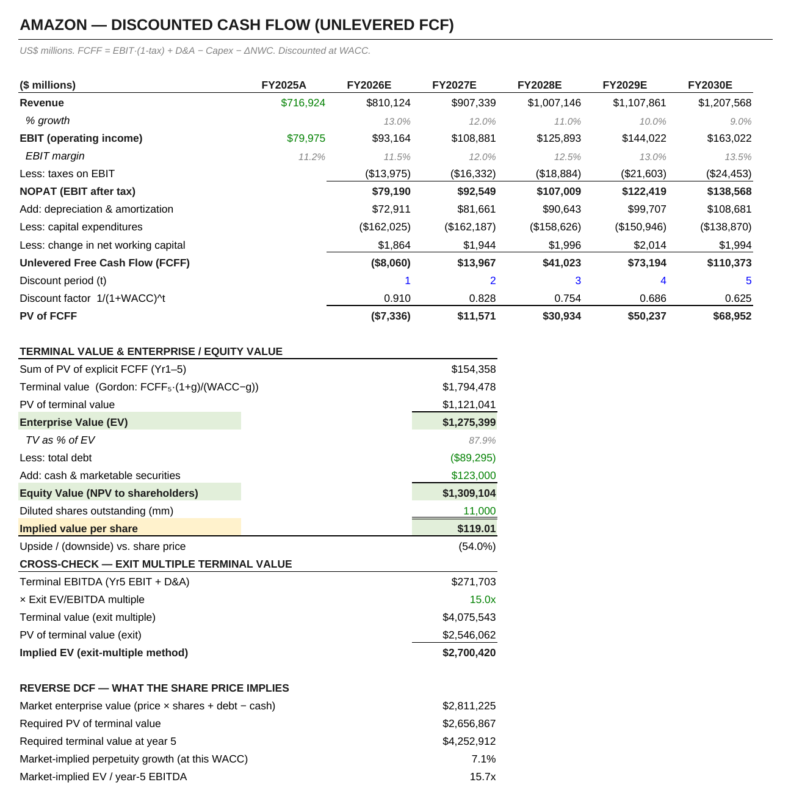
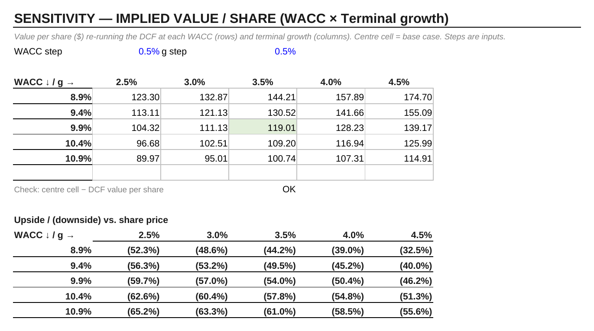

# Amazon.com (NASDAQ: AMZN): valuation model

**File:** `Amazon_Valuation_Model.xlsx`. Market data as of 21 Aug 2026; financials from the FY2025 Form 10-K.

The model values Amazon three ways and then asks what the share price implies.

| | US$ per share |
|---|---|
| Five-year unlevered DCF (Gordon terminal value) | 119.01 |
| Trading comparables (EV/EBITDA and P/E, MSFT / GOOGL / META) | 206.61 |
| Residual income | 91.03 |
| Share price, 21 Aug 2026 | 258.63 |

The other key figures:

| | |
|---|---|
| WACC | 9.9% |
| Terminal value as a share of EV | 88% |
| Market-implied perpetual growth (reverse DCF) | 7.1% |
| Market-implied year-5 EV/EBITDA | 15.7x |

## Reading it

Capital expenditure on AI and data centres is 20% of revenue in year 1 and steps down to 11.5% by year 5. That holds down near-term free cash flow, so 88% of the DCF value sits in the terminal value.

At the August 2026 price, the market implies about 7% perpetual growth, or a 15.7x exit EBITDA multiple. That is close to the model's own exit-multiple cross-check, which assumes 15x. The DCF is therefore conservative on the long run rather than wrong about the next five years.

## Changes made before publication

These are also listed on the workbook's cover sheet.

- The base-year EBIT on the DCF sheet now links to Assumptions. It was a typed number.
- The capex schedule is now driven by Assumptions. The percentages had been typed into each formula, and the terminal input was unused.
- The sensitivity tables were rebuilt so their headers centre on the live WACC and g, and a check cell was added.
- I added a share price, a valuation date and a reverse DCF. The risk-free rate is now the 21 Aug 2026 10-year yield (4.74%, previously "4.3% approx.").
- Residual income: opening book equity is now $411.1bn per the 10-K. It was ~$300bn.

## Limitations

- Year-end discounting, with no stub period for the part of FY2026 already earned.
- Debt excludes lease liabilities.
- Peer multiples are approximate.

Not investment advice.
