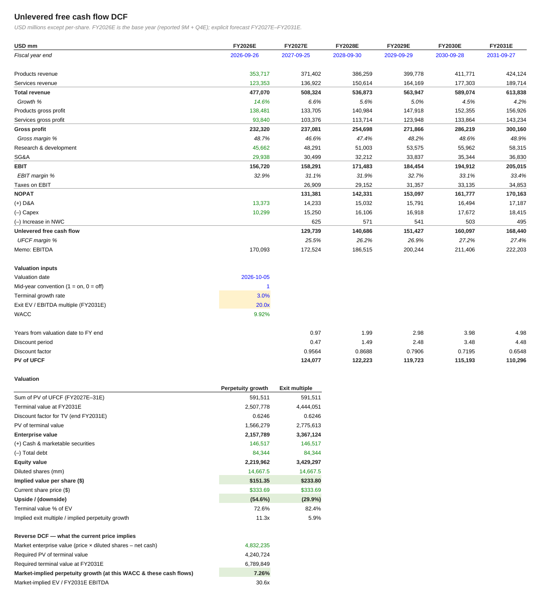
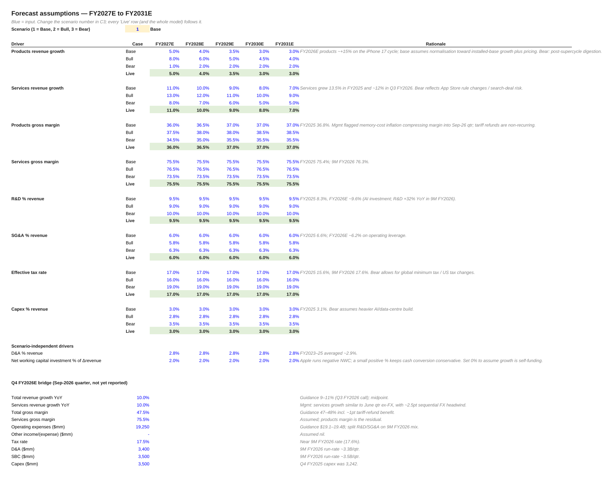

# Apple (NASDAQ: AAPL): DCF valuation

**File:** `Apple_DCF_Model.xlsx`.
- Market data: 2 Oct 2026 close.
- Balance sheet: 27 Jun 2026 (Q3 FY2026 10-Q).

## What the model does

It rebuilds FY2023 to 9M FY2026 from Apple's filings. It bridges to FY2026E with a Q4 estimate taken from management guidance.

It then forecasts products and services separately (growth and gross margin) for FY2027E–FY2031E, under Base, Bull and Bear scenarios. A single cell switches the scenario.

| Base case | |
|---|---|
| Value per share, perpetuity growth (3.0%) | $151.35 |
| Value per share, exit multiple (20x EBITDA) | $233.80 |
| Blended | $192.58 |
| Share price, 2 Oct 2026 | $333.69 |
| WACC | 9.9% |
| Market-implied perpetual growth | 7.3% |
| Market-implied FY2031E EV/EBITDA | 30.6x |

## Reading it

On base-case cash flows, the price needs either about 7% growth forever or a 30x EBITDA exit. The gap is the market's confidence in services growth and buybacks, which the base case does not give.

## Notes

- Q4 FY2026 is an estimate. Apple reports FY2026 around the end of October 2026; overwrite Assumptions rows 53–62 when it does.
- SBC is treated as a cost.
- Explicit cash flows use mid-year timing.
- The audit found no formula errors and no hard-codes inside formulas. The logic is unchanged; I restyled the workbook and added a cover sheet.

Not investment advice.
