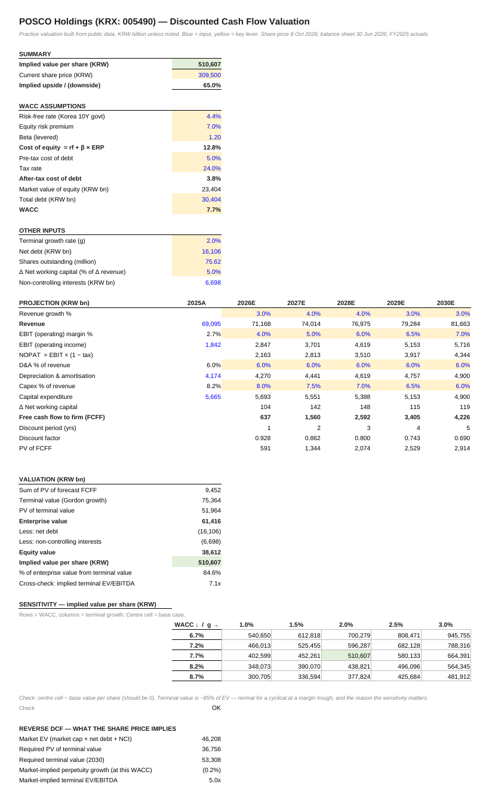

# POSCO Holdings (KRX: 005490): DCF valuation

**File:** `POSCO_Holdings_DCF.xlsx`.
- Share price: 8 Oct 2026.
- Balance sheet: 30 Jun 2026.
- Actuals: FY2025.
- Units: KRW billion unless noted.

## What the model does

POSCO earned a 2.7% operating margin in FY2025, a trough against a mid-cycle 6–9%. The model lets margins recover to 7% by 2030 while battery-materials capex fades from 8% to 6% of revenue. It then asks how much of that recovery the share price already assumes.

| | |
|---|---|
| Implied value per share | ₩510,600 |
| Share price, 8 Oct 2026 | ₩309,500 |
| WACC | 7.7% |
| Terminal value share of EV | 85% |
| Implied terminal EV/EBITDA | 7.1x |
| Market-implied perpetual growth | −0.2% |
| Market-implied terminal EV/EBITDA | 5.0x |

## Reading it

The price is consistent with no growth and a 5x EBITDA multiple, roughly where steel peers trade. The upside in the model comes almost entirely from assuming the margin recovers to 7%. That assumption is the one to challenge.

## Changes made before publication

- Share price updated from ₩395,000 (early June 2026) to ₩309,500 (8 Oct 2026).
- Risk-free rate updated from 3.2% to 4.41% (Korea 10-year, late September 2026), consistent with the portfolio workbook.
- Shares outstanding changed from 79.25mn to 75.62mn, excluding treasury shares after the 2024–26 cancellations.
- Non-controlling interests (₩6.7tn) are now deducted in the equity bridge. They were previously omitted.
- The sensitivity table is centred on the live WACC and g, with a check cell and a reverse DCF added.

## Limitations

- Holding-company structure: no sum-of-the-parts and no holding-company discount.
- Year-end discounting.

Not investment advice.
