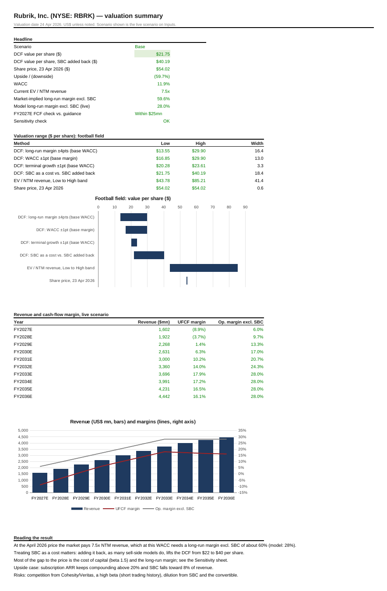
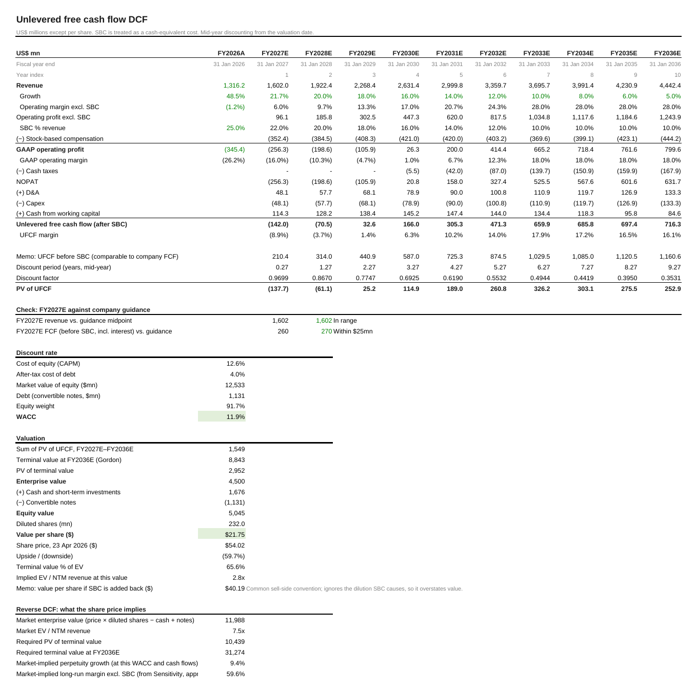

# Rubrik (NYSE: RBRK): equity valuation

**File:** `Rubrik_Valuation_Model.xlsx`.
- Valuation date: 24 Apr 2026 (share price of 23 Apr 2026).
- Uses only information public on that date: FY2026 results and FY2027 guidance (8-K, 12 Mar 2026).

This started as a team project, and I built the valuation. This version is my rebuild of it.

## What the model does

Rubrik sells data-security and backup software on subscription. FY2026 revenue grew 48% to $1.3bn. The company is free-cash-flow positive because customers pay upfront, but it still reports GAAP operating losses and pays 25% of revenue in stock-based compensation.

- A 10-year unlevered DCF lets growth fade before the terminal value. SBC is treated as a cost.
- Base, Bull and Bear scenarios are selected with one switch.
- FY2027E is pinned to guidance, and a check cell reconciles FY2027E free cash flow to the guided $265–275mn.
- EV / NTM revenue bands and a reverse DCF complete the picture.

| Base case | |
|---|---|
| DCF value per share | $21.75 |
| DCF value per share if SBC is added back | $40.19 |
| Share price, 23 Apr 2026 | $54.02 |
| WACC | 11.9% |
| Current EV / NTM revenue | 7.5x |
| Bull case (SBC as cost / added back) | $35.40 / $53.67 |
| Bear case (SBC as cost / added back) | $9.84 / $26.90 |

## Reading it

The April 2026 price matches the bull case, but only if stock-based compensation is ignored, as many sell-side models do. Treated as a cost at a 12% cost of capital, the price needs long-run margins no listed software company earns.

The two inputs that move the answer most are the beta (1.5, from a short trading history) and the long-run margin. The Sensitivity sheet shows both.

## What changed from the original team model

- **FY2026 is now actual, not an estimate.** Results were reported in March 2026, before the valuation date. Historical figures were restated to GAAP from the 8-K.
- **Revenue growth.** FY2027 growth is pinned to guidance (+21.7%). The original model assumed +40%.
- **WACC.** It now uses market-value weights (equity about 92%). The original sheet used 52/48, which understated the WACC.
- **Forecast length.** The forecast now runs ten years instead of five, so the terminal value is not struck while the company is still growing 26%.
- **Formulas.** Every calculation is a formula on one Inputs sheet. The original summary pointed at the wrong cells.
- **Methods removed.** Residual income was dropped because book equity was negative, which makes the method unreliable. FCFE was dropped because it duplicated the DCF.
- **Peer data.** The Bloomberg peer screen is not reproduced because it is licensed data. The EV / NTM revenue bands remain as inputs.

Not investment advice.
