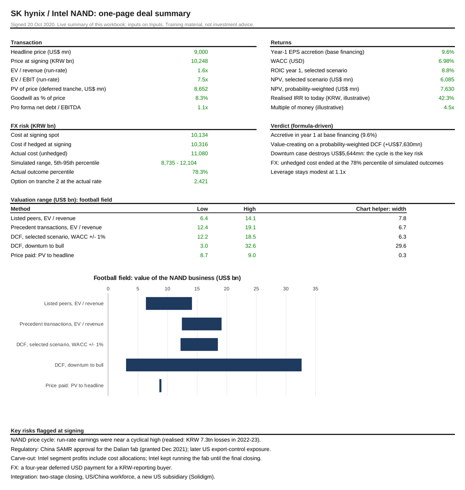
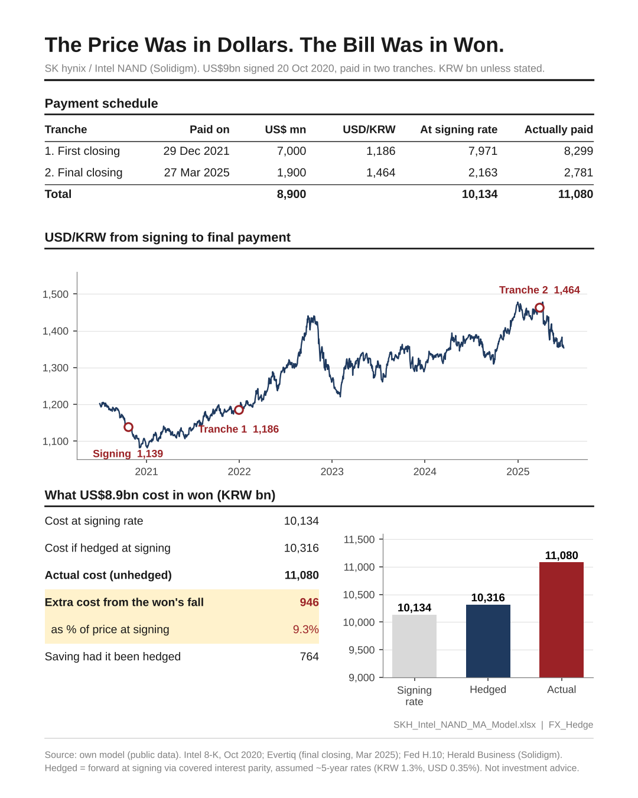
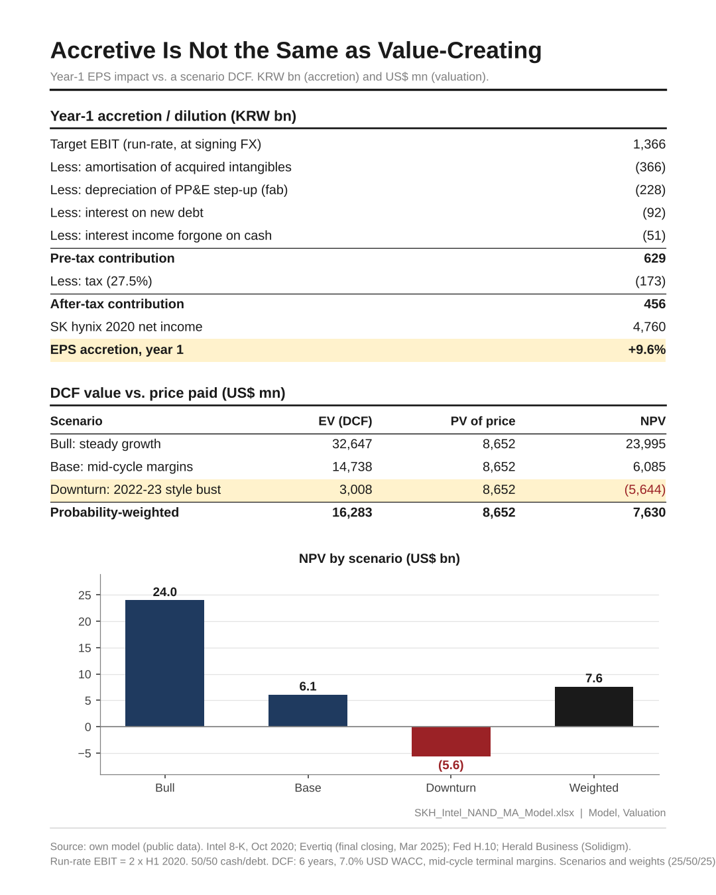
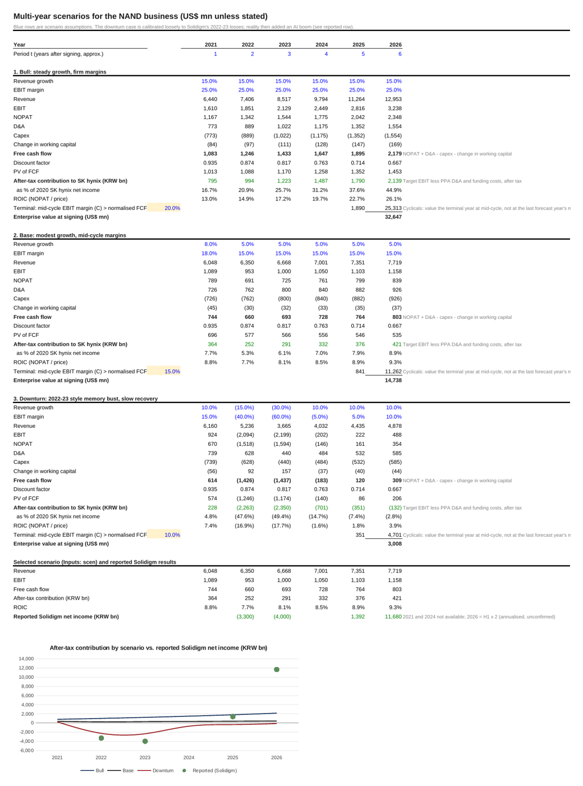

# SK hynix / Intel NAND (Solidigm): a cross-border M&A case model

An Excel model of SK hynix's US$9bn acquisition of Intel's NAND and SSD business, signed in October 2020 and paid in two tranches (December 2021 and March 2025). It works through the questions an M&A team asks at signing, then checks them against what actually happened.

Every number in the workbook is a live Excel formula on a single Inputs sheet, so you can change an assumption and the whole model updates.

## Questions the model answers

1. **Is the deal accretive?** Year-1 EPS impact after purchase-price-allocation D&A, funding costs and tax.
2. **Is it value-creating?** A six-year DCF under bull, base and downturn scenarios, with NPV against the present value of the price, and ROIC vs. WACC.
3. **What did the won do to the price?** The USD price was paid in two tranches, the second four years later. The model compares the cost at the signing rate, the cost hedged with a forward at signing, the actual cost, and an option hedge.
4. **What did it cost to structure it this way?** Sources and uses, the value of deferred consideration, purchase price allocation and goodwill, and pro forma leverage.
5. **How does the price compare?** Precedent NAND transactions, listed peers, and a football field.
6. **What happened afterwards?** Solidigm's reported results compared with the signing-date model.

## Headline results (base inputs)

| | |
|---|---|
| Price paid | US$9.0bn headline; US$8.65bn in present value terms (deferred tranche) |
| Multiple | 1.6x revenue, 7.5x EBIT (run-rate, H1 2020 x 2) |
| Year-1 EPS accretion | +9.6% (50% cash, 50% debt) |
| NPV, bull / base / downturn | +US$24.0bn / +US$6.1bn / -US$5.6bn |
| NPV, probability-weighted (25/50/25) | +US$7.6bn |
| Extra KRW cost from the won's fall | KRW 946bn (9.3% of the price at signing) |
| Saving had it been hedged at signing | ~KRW 764bn (assumed hedge rates) |
| Pro forma net debt / EBITDA | 0.6x to 1.1x |

The deal looked accretive at signing, but its value depended on the memory cycle. Solidigm lost about KRW 7.3tn in 2022-23 and then became highly profitable on AI data-centre demand.

## Workbook guide

| Sheet | Contents |
|---|---|
| Cover | Key live outputs and how to use the model |
| Summary | One-page deal summary with a football field and formula-driven verdicts |
| Inputs | Every assumption with its source; shaded cells are the ones to flex |
| Deal_Structure | Sources and uses, PV of deferred consideration, purchase price allocation, credit metrics |
| Model | Year-1 accretion/dilution, and why: target yield vs. after-tax cost of funding |
| Scenarios | 2021-26 cash flows for three scenarios, terminal value at mid-cycle margins |
| Valuation | WACC, DCF, NPV by scenario, WACC sensitivity, ROIC vs. WACC, realised IRR (illustrative) |
| Comps | Precedent NAND deals and listed memory peers (EV / revenue) |
| FX_Hedge | KRW cost by tranche, forward at signing, forward vs. option (Garman-Kohlhagen) |
| FX_MonteCarlo | 2,000 simulated USD/KRW paths for the KRW cost of the deal |
| Sensitivity | Accretion by synergies x debt share, earnings FX x price FX, stock funding x share price |
| Post_Mortem | Solidigm reported results vs. the signing-date run-rate |
| Practice | 17 interview-style questions with live answers |
| Sources | Links |

## Method notes

- **Terminal value at mid-cycle margins.** Memory is cyclical, so valuing the final forecast year's margin into perpetuity would overstate a boom and understate a bust.
- **Deferred consideration is seller financing.** The second tranche is discounted at SK hynix's USD cost of debt (5-year bond, January 2021).
- **Hedge pricing.** The forward uses covered interest parity. The option is a USD call / KRW put struck at the forward, priced with Garman-Kohlhagen using realised USD/KRW volatility from the five years before signing.
- **Monte Carlo.** USD/KRW is modelled as lognormal with forward drift. The random draws are stored as values, so results are reproducible.

## Assumptions and limitations

Highlighted inputs are my assumptions: financing mix, costs of funding, PPA split, scenario growth and margins, WACC inputs, and hedge rates. Several inputs are approximations and are marked in the workbook. Check them before relying on the numbers:

- SK hynix 2020 net debt and EBITDA
- Toshiba Memory revenue
- Micron and Western Digital enterprise values
- Solidigm's 2025-26 results and the reported pre-IPO valuation, which come from a single press report

Target financials are Intel's segment figures, which include cost allocations. The realised IRR is illustrative only.

## Sources

- Intel 8-K, deal terms and NAND H1 2020 financials: https://www.sec.gov/Archives/edgar/data/50863/000119312520272580/d76122dex991.htm
- First closing after China SAMR clearance (Dec 2021): https://www.eetasia.com/?p=34510
- Final closing, 27 March 2025: https://evertiq.com/design/2025-04-01-sk-hynix-completes-its-acquisition-of-intels-nand-business/
- SK hynix FY2020 results: https://www.koreajoongangdaily.com/business/sk-hynixs-2020-net-profit-exceeds-expectations-growing-twofold-on-year/11673498
- SK hynix US$2.5bn bonds, January 2021: http://www.kedglobal.com/bond-issues/newsView/ked202101140004
- Solidigm results: https://biz.heraldcorp.com/article/10843248
- Western Digital / SanDisk: https://www.sec.gov/Archives/edgar/data/0000106040/000119312515349064/d20974dex991.htm
- Bain consortium / Toshiba Memory: https://www.datacenterknowledge.com/data-center-chips/bain-led-group-to-buy-toshiba-chip-unit-in-18b-deal
- USD/KRW: Federal Reserve H.10 (FRED DEXKOUS)

## Disclaimer

This is a training case built on public information. It is not investment advice and is not affiliated with SK hynix, Intel or Solidigm.

Author: Jung Ryul Lee. Related: [krw-fx-monitor](https://github.com/jungrlee/krw-fx-monitor) · [other valuation models](../).
