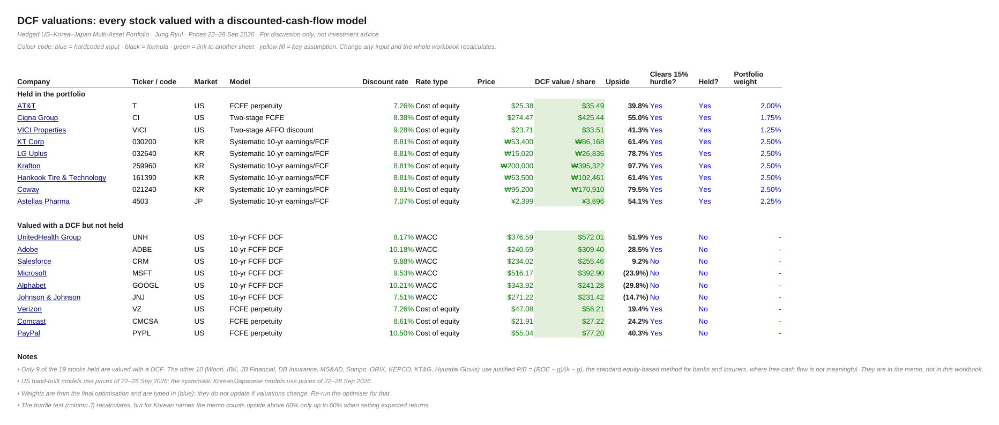
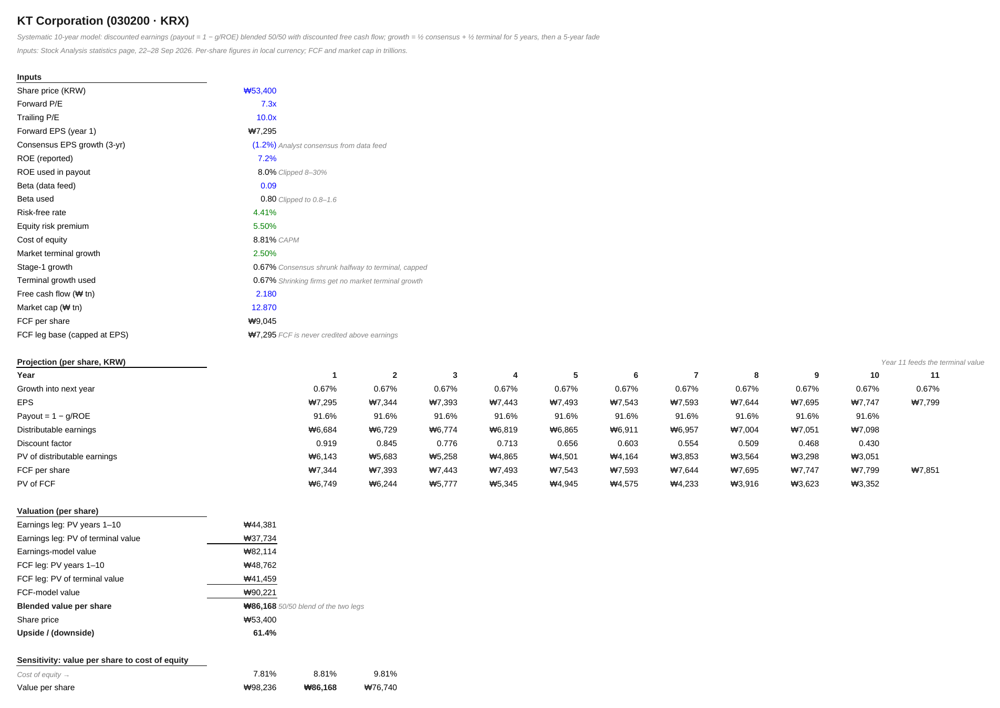

# Hedged US–Korea–Japan portfolio: DCF valuations

**File:** `Portfolio_DCF_Valuations.xlsx`. Prices from 22–28 Sep 2026.

These are the valuation workings behind a hedged multi-asset portfolio of US, Korean and Japanese stocks. Every stock that can sensibly be valued on cash flows is valued here. All models draw on one shared Assumptions sheet: risk-free rate, equity risk premium and terminal growth for each market.

| Group | Stocks | Model |
|---|---|---|
| US large caps | UNH, ADBE, CRM, MSFT, GOOGL, JNJ | 10-year FCFF DCF (revenue × fading FCF margin, WACC) |
| US income | T, VZ, CMCSA, PYPL, CI, VICI | FCFE perpetuity, two-stage FCFE or AFFO, at the cost of equity |
| Korea / Japan | KT, LG Uplus, Krafton, Hankook Tire, Coway, Astellas | Systematic 10-year model: discounted earnings (payout = 1 − g/ROE) blended 50/50 with discounted FCF, with limits on beta, growth and ROE |

14 of the 18 stocks clear the 15% upside hurdle used in portfolio selection.

## The 18 models

| Stock | Code | Model | Value / share | Price | Upside | Held | File |
|---|---|---|---|---|---|---|---|
| Adobe | ADBE | 10-yr FCFF DCF | $309.40 | $240.69 | +28.5% | No | [xlsx](models/ADBE_Adobe_DCF.xlsx) |
| Alphabet | GOOGL | 10-yr FCFF DCF | $241.28 | $343.92 | -29.8% | No | [xlsx](models/GOOGL_Alphabet_DCF.xlsx) |
| Johnson & Johnson | JNJ | 10-yr FCFF DCF | $231.42 | $271.22 | -14.7% | No | [xlsx](models/JNJ_Johnson_Johnson_DCF.xlsx) |
| Microsoft | MSFT | 10-yr FCFF DCF | $392.90 | $516.17 | -23.9% | No | [xlsx](models/MSFT_Microsoft_DCF.xlsx) |
| Salesforce | CRM | 10-yr FCFF DCF | $255.46 | $234.02 | +9.2% | No | [xlsx](models/CRM_Salesforce_DCF.xlsx) |
| UnitedHealth Group | UNH | 10-yr FCFF DCF | $572.01 | $376.59 | +51.9% | No | [xlsx](models/UNH_UnitedHealth_Group_DCF.xlsx) |
| AT&T | T | FCFE perpetuity | $35.49 | $25.38 | +39.8% | Yes | [xlsx](models/T_AT_T_DCF.xlsx) |
| Comcast | CMCSA | FCFE perpetuity | $27.22 | $21.91 | +24.2% | No | [xlsx](models/CMCSA_Comcast_DCF.xlsx) |
| PayPal | PYPL | FCFE perpetuity | $77.20 | $55.04 | +40.3% | No | [xlsx](models/PYPL_PayPal_DCF.xlsx) |
| Verizon | VZ | FCFE perpetuity | $56.21 | $47.08 | +19.4% | No | [xlsx](models/VZ_Verizon_DCF.xlsx) |
| VICI Properties | VICI | Two-stage AFFO discount | $33.51 | $23.71 | +41.3% | Yes | [xlsx](models/VICI_VICI_Properties_DCF.xlsx) |
| Cigna Group | CI | Two-stage FCFE | $425.44 | $274.47 | +55.0% | Yes | [xlsx](models/CI_Cigna_Group_DCF.xlsx) |
| Coway | 021240 | Systematic 10-yr earnings/FCF | ₩170,910 | ₩95,200 | +79.5% | Yes | [xlsx](models/021240_Coway_DCF.xlsx) |
| Hankook Tire & Technology | 161390 | Systematic 10-yr earnings/FCF | ₩102,461 | ₩63,500 | +61.4% | Yes | [xlsx](models/161390_Hankook_Tire_Technology_DCF.xlsx) |
| KT Corp | 030200 | Systematic 10-yr earnings/FCF | ₩86,168 | ₩53,400 | +61.4% | Yes | [xlsx](models/030200_KT_Corp_DCF.xlsx) |
| Krafton | 259960 | Systematic 10-yr earnings/FCF | ₩395,322 | ₩200,000 | +97.7% | Yes | [xlsx](models/259960_Krafton_DCF.xlsx) |
| LG Uplus | 032640 | Systematic 10-yr earnings/FCF | ₩26,836 | ₩15,020 | +78.7% | Yes | [xlsx](models/032640_LG_Uplus_DCF.xlsx) |
| Astellas Pharma | 4503 | Systematic 10-yr earnings/FCF | ¥3,696 | ¥2,399 | +54.1% | Yes | [xlsx](models/4503_Astellas_Pharma_DCF.xlsx) |

## Notes

- **The systematic model is a screening tool.** It runs on consensus and statistics from data feeds. Large upsides for Korean names mostly reflect low P/E multiples, not company-specific forecasts.
- **Financials are not here.** Banks and insurers in the portfolio were valued with justified P/B in the memo. The memo is not included.
- **Weights are typed in.** Portfolio weights come from the optimiser and do not move when valuations change.
- **Changes before publication.** The audit found no formula errors, and the logic is unchanged. I restyled the workbook and added a cover sheet.

Not investment advice.
